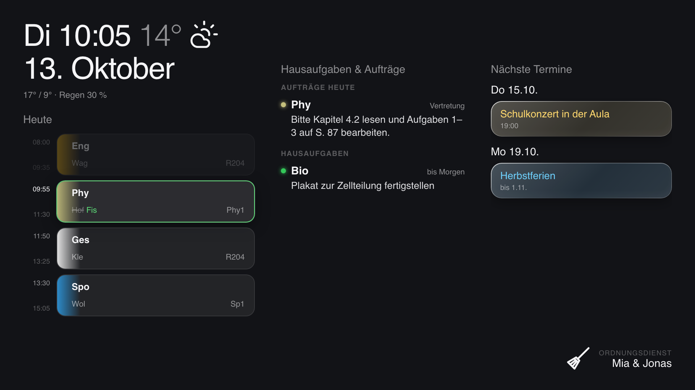
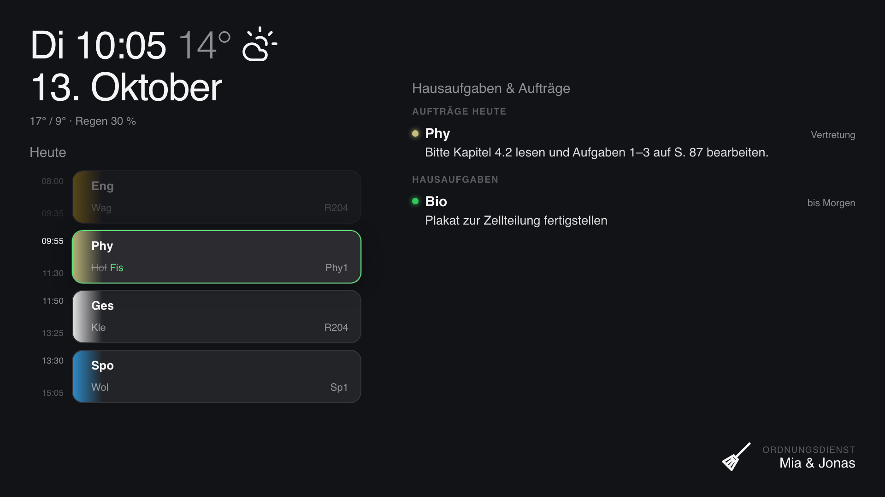
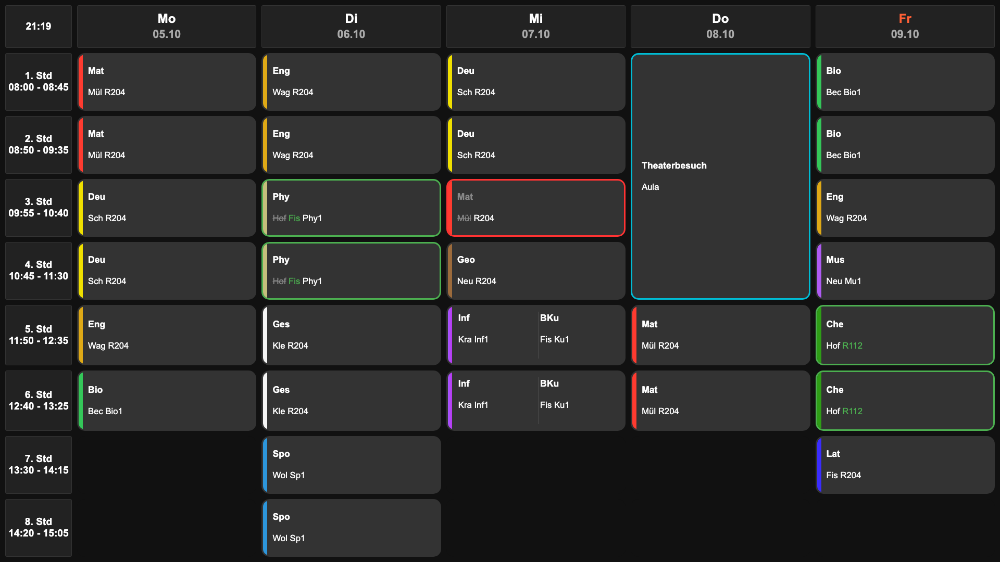

# raspy – classroom timetable display for WebUntis

A Raspberry Pi + any HDMI screen on the classroom wall that shows **today's lessons with
substitutions and cancellations, homework, teacher notes, upcoming dates and the weather**,
pulled live from [WebUntis](https://webuntis.com). Built by students for their own classroom.



| Without a calendar (Untis only) | Week view |
|---|---|
|  |  |

The display itself is in German (that's where WebUntis is used most); setup and docs are in English.

## Features

- **Today view** (`/heute`) – lessons as cards (double periods merged, parallel courses side by
  side, current lesson highlighted, past ones dimmed), substitutions in green, cancellations in red,
  events in blue. After the last lesson it switches to the next school day.
- **Homework & teacher notes** from Untis, plus the **class duty** ("Ordnungsdienst").
- **Optional calendar** – any secret iCal link (Google, iCloud, Outlook) for tests, trips, holidays.
  Without one, the page uses a two-column layout.
- **Optional weather** via [Open-Meteo](https://open-meteo.com) (no API key).
- **Week view** (`/`) – the whole week; rows come from your school's own period times.
- **Keeps working when the Wi-Fi drops** – shows the last known state with a "Stand HH:MM" hint.
- **Screen schedule** – always on during school hours, off when idle otherwise (or simply always on).
- Pi extras (all optional): **two hardware buttons** (switch view / hold to shut down),
  **smooth fan curve + overheat protection** (Pi 5), **weekly auto-updates**
  that are safe to interrupt (off by default), and a **custom boot animation**.

## What you need

- Raspberry Pi (tested on a **Pi 5, 4 GB** with the Active Cooler) and a 1920×1080 screen
- **Raspberry Pi OS with desktop** (Debian 12 or 13), connected to the internet
- A WebUntis login that can see your class timetable – ideally a separate account just for the display

## Install

On the Pi, open a terminal:

```bash
git clone https://github.com/jstarndmprsn/untis-dashboard.git
cd untis-dashboard
./install.sh
```

The installer asks a few questions and does the rest:

1. **Which extras** you want (buttons, fan control, auto-updates, boot animation).
2. **Your school** – type its name and pick it from the list (same search as the Untis app),
   or paste the address of your WebUntis login page.
3. **Username and password** – tested right away; the password is typed hidden.
4. **Your class** – your own class is suggested automatically.
5. **Calendar** (optional) and **town for the weather** (optional).
6. **Screen schedule** – when the screen should stay on, or keep it on all the time.

Everything ends up in `config.env` (only readable by your user, never committed). Then it
installs the services, sets Chromium to start in full screen after login, and reboots.

Change settings later with `./install.sh --configure`. It opens a menu, so you only change what you need:

```
raspy settings
   1  School           gym-musterstadt on xyz.webuntis.com
   2  Login            display7a
   3  Class            7a
   4  Class duty       Klassenordner
   5  Calendar         on
   6  Weather          Musterstadt
   7  Screen schedule  Mon–Fri 07:30–16:00 on, otherwise off after 10 min idle

   t  Test the settings
   s  Save and exit
   q  Quit without saving
```

Nothing is written until you press `s`; then the web server is restarted and the screen schedule applied
right away. `./install.sh --configure --wizard` walks through every step instead. To add or remove
extras (buttons, fan, updates, boot animation), run `./install.sh` again.

To update: `git pull && ./install.sh`. What changed is in the [changelog](CHANGELOG.md).

## Try it without a Pi

Demo mode uses made-up data (class "9a" with a substitution, a cancellation, a trip …):

```bash
python3 -m venv venv && venv/bin/pip install -r app/requirements.txt
venv/bin/python app/server.py --demo        # add --no-calendar for the two-column layout
```

Then open <http://localhost:5000/heute> and <http://localhost:5000/>. Add
`?tag=2026-10-13T10:00` to `/heute` to preview any point in time.

## Getting a calendar link

**Google Calendar** (on a computer): Settings → pick the calendar under "Settings for my calendars" →
*Integrate calendar* → **Secret address in iCal format**. Anyone with this link can read the
calendar, so treat it like a password. Event colours come from keywords in the title
(*Arbeit/Test/Klausur* green, *Ferien* blue, *Geburtstag* red, *Ausflug/Konzert* yellow; see
`CALENDAR_COLOR_RULES` in `app/dashboard.py`).

## Screen schedule

So the screen isn't lit all night and weekend, raspy switches it off when nobody needs it:

- **Mon–Fri during school hours** (default 07:30–16:00) the screen is always on.
- **At other times** it turns off after 10 minutes without a button press. Any button (or a keyboard/mouse) wakes it up.

Change the times or turn the schedule off with `./install.sh --configure` → **Screen schedule**.
When it is off, the screen stays on all the time. The change takes effect immediately.

## Buttons

Two push buttons, each between a GPIO pin and GND (internal pull-up, no resistors needed).
Pins can be changed in `config.env`.

| Button | Wiring (default) | Press | Hold |
|---|---|---|---|
| Tab | GPIO 17 (pin 11) + GND (pin 9) | switch Today ⇄ Week | 3 s: close Chromium (shows desktop) |
| Power | GPIO 27 (pin 13) + GND (pin 14) | wake the screen | countdown, then shut down |
| Both | | | 2 s: system/temperature dashboard |

If system updates are running, holding Power first finishes the current package safely, then shuts down.

## Configuration

The easiest way to change settings is the menu: `./install.sh --configure` (see [Install](#install)).
All settings are stored in `config.env` (see [`config.example.env`](config.example.env)). After editing it by
hand: `sudo systemctl restart raspy-web`.

| Setting | Meaning |
|---|---|
| `UNTIS_SERVER`, `UNTIS_SCHOOL` | e.g. `xyz.webuntis.com` and the school's login name |
| `UNTIS_USER`, `UNTIS_PASSWORD` | the Untis login |
| `UNTIS_CLASS` | class name, e.g. `7a` – the ID is looked up automatically each school year |
| `DUTY_LABEL` | class duty to show (as named in Untis, default `Klassenordner`; empty = hide) |
| `CALENDAR_ICS_URL` | optional iCal link; empty = no calendar column |
| `WEATHER_LAT`, `WEATHER_LON` | optional; empty = no weather |
| `SCREEN_SCHEDULE` | `1` = use the screen schedule below, `0` = screen always on |
| `SCREEN_ON_FROM`, `SCREEN_ON_UNTIL`, `SCREEN_IDLE_OFF` | screen always on Mon–Fri in this window, otherwise off after N seconds idle |
| `BUTTON_TAB_GPIO`, `BUTTON_POWER_GPIO`, `PORT` | hardware pins, web server port |

Subject colours are in `SUBJECT_COLORS` in `app/dashboard.py`; unknown subjects get a stable colour of their own.

## Troubleshooting

```bash
journalctl -u raspy-web -f                # web server / Untis errors
venv/bin/python app/configure.py --check  # test login, class and calendar
```

- **"Untis-Login abgelehnt"** – wrong username/password, or the account was locked; run `./install.sh --configure`.
  After a rejected login raspy only retries every 30 minutes, so it can't get the account locked.
- **No homework / class duty** – not every school allows student accounts to see them; the rest still works.
- **Screen stays black / desktop shows** – raspy needs the X11 desktop session. The installer offers
  to switch from Wayland; otherwise use `sudo raspi-config` → Advanced Options → Wayland → X11.
- **Pages from another device**: by default the web server only listens on the Pi itself (the kiosk
  is all that needs it). Set `LAN_ACCESS=1` in `config.env` and restart (`sudo systemctl restart raspy-web`)
  to open `http://<pi-name>.local:5000/heute`, `/` and `/thermal` from elsewhere – there is no login,
  so only do this on a network you trust.

## Uninstall

```bash
./install.sh --uninstall
```

This removes the services and puts back the system files it changed (backups are in `/var/backups/raspy`).
Your `config.env` stays until you delete the folder.

## Project layout

```
app/          Flask server: server.py (app + week view page), week.py (week table), dashboard.py
              (/heute + all Untis data), thermal.py (/thermal), untis.py (WebUntis client),
              configure.py (setup), demo.py, templates/, static/
tests/        pytest suite (python -m pytest), runs in CI together with shellcheck
device/       runs on the Pi: buttons, overlays, fan/overheat guard, boot splash, kiosk, screen schedule
system/       systemd units and config templates used by install.sh
boot/         boot animation generator (make_frames.py) and logo
```

## Privacy & good manners

- The screen shows teacher abbreviations and the first names of the students on class duty.
  Think about who can see it, and **ask your school before putting it up** – it's their WebUntis.
- `config.env` contains your Untis password and calendar link. It's in `.gitignore`; keep it that way.
- raspy uses the same (unofficial) WebUntis API as many open-source clients. It is not affiliated
  with Untis GmbH. It only reads data, polls every 2 minutes and keeps one login session open
  instead of logging in for every poll.

## License

[MIT](LICENSE)
