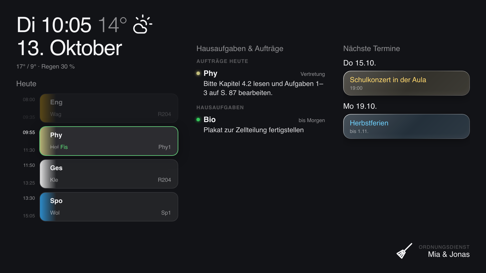
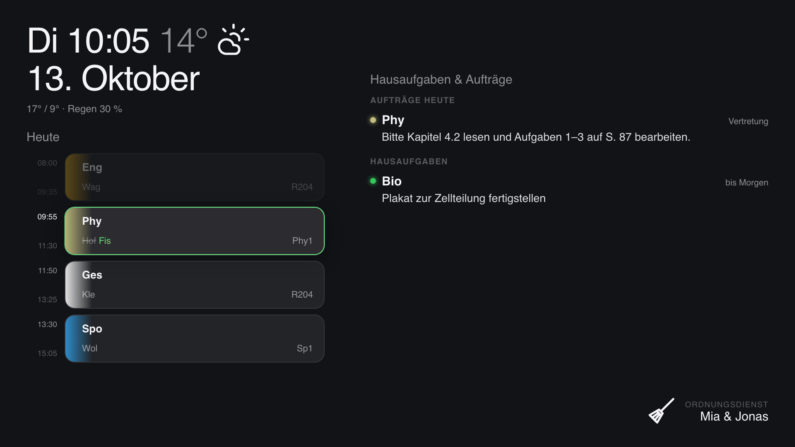
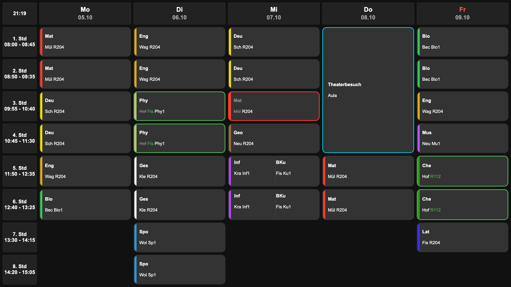

# raspy – classroom timetable display for WebUntis

A Raspberry Pi + any HDMI screen on the classroom wall that shows **today's lessons with
substitutions and cancellations, homework, teacher notes, upcoming dates and the weather**,
pulled live from [WebUntis](https://webuntis.com). Built by students for their own classroom.



| Without a calendar (Untis only) | Week view |
|---|---|
|  |  |

The display itself is in German (that's where WebUntis is used most); setup and docs are in English.

## Features

- **Today view** (`/heute`) – lessons as cards (double periods merged, parallel courses side by
  side, current lesson highlighted, past ones dimmed), substitutions in green, cancellations in red,
  events in blue. After the last lesson it switches to the next school day.
- **Homework & teacher notes** from Untis, plus the **class duty** ("Ordnungsdienst").
- **Optional calendar** – any secret iCal link (Google, iCloud, Outlook) for tests, trips, holidays.
  Without one, the page uses a two-column layout.
- **Optional weather** via [Open-Meteo](https://open-meteo.com) (no API key).
- **Week view** (`/`) – the whole week; rows come from your school's own period times.
- **Keeps working when the Wi-Fi drops** – shows the last known state with a "Stand HH:MM" hint.
- **Screen schedule** – always on during school hours, off when idle otherwise (or simply always on).
- **Fits your hardware** – the pages scale to any screen (720p to 4K, 16:10, 4:3, ultra-wide),
  plus settings for resolution, rotation and TV overscan, button wiring and timing, temperature
  limits and the fan curve. See [Adapting raspy to your hardware](docs/hardware.md).
- Pi extras (all optional): **two hardware buttons** (switch view / hold to shut down),
  **overheat protection** with a **smooth fan curve** on a Pi 5, **weekly auto-updates**
  that are safe to interrupt (off by default), a **custom boot animation**, and a
  **software watchdog** that installs released versions by itself (see below).

## What you need

- Raspberry Pi (tested on a **Pi 5, 4 GB** with the Active Cooler) and any HDMI screen or TV –
  the pages scale to its resolution (designed for 1920×1080; other setups: [hardware guide](docs/hardware.md))
- **Raspberry Pi OS with desktop** (Debian 12 or 13), connected to the internet
- A WebUntis login that can see your class timetable – ideally a separate account just for the display

## Install

On the Pi, open a terminal:

```bash
git clone https://github.com/jstarndmprsn/untis-dashboard.git
cd untis-dashboard
./install.sh
```

The installer asks a few questions and does the rest:

1. **Which extras** you want (buttons, overheat protection/fan, auto-updates, boot animation).
2. **Your school** – type its name and pick it from the list (same search as the Untis app),
   or paste the address of your WebUntis login page.
3. **Username and password** – tested right away; the password is typed hidden.
4. **Your class** – your own class is suggested automatically.
5. **Calendar** (optional) and **town for the weather** (optional).
6. **Screen schedule** – when the screen should stay on, or keep it on all the time.

Everything ends up in `config.env` (only readable by your user, never committed). Then it
installs the services, sets Chromium to start in full screen after login, and reboots.

Change settings later with `./install.sh --configure`. It opens a menu, so you only change what you need:

```
raspy settings
   1  School           gym-musterstadt on xyz.webuntis.com
   2  Login            display7a
   3  Class            7a
   4  Class duty       Klassenordner
   5  Calendar         on
   6  Weather          Musterstadt
   7  Screen schedule  Mon–Fri 07:30–16:00 on, otherwise off after 10 min idle
   8  Display          resolution as set by the system
   9  Buttons          tab = GPIO 17, power = GPIO 27
  10  Temperature      shutdown above 85 °C, fan from 45 °C, full at 83 °C

   t  Test the settings
   s  Save and exit
   q  Quit without saving
```

*Buttons* and *Temperature* appear when those extras are installed. Nothing is written until you
press `s`; then everything is applied right away (web server, buttons, overheat protection, screen
schedule, resolution/rotation). `./install.sh --configure --wizard` walks through every step instead. To add or remove
extras (buttons, fan, updates, boot animation), run `./install.sh` again.

To update: `git pull && ./install.sh`. What changed is in the [changelog](CHANGELOG.md).

Working remotely over SSH? `./install.sh --keep-boot --no-reboot` leaves the boot setup
(boot animation, `cmdline.txt`, initramfs) untouched and doesn't reboot – start the kiosk with
`sudo systemctl restart lightdm` instead. That way a typo can't stop the Pi from booting while
nobody can reach it.

## Try it without a Pi

Demo mode uses made-up data (class "9a" with a substitution, a cancellation, a trip …):

```bash
python3 -m venv venv && venv/bin/pip install -r app/requirements.txt
venv/bin/python app/server.py --demo        # add --no-calendar for the two-column layout
```

Then open <http://localhost:5000/heute> and <http://localhost:5000/>. Add
`?tag=2026-10-13T10:00` to `/heute` to preview any point in time.

## Getting a calendar link

**Google Calendar** (on a computer): Settings → pick the calendar under "Settings for my calendars" →
*Integrate calendar* → **Secret address in iCal format**. Anyone with this link can read the
calendar, so treat it like a password. Event colours come from keywords in the title
(*Arbeit/Test/Klausur* green, *Ferien* blue, *Geburtstag* red, *Ausflug/Konzert* yellow; see
`CALENDAR_COLOR_RULES` in `app/dashboard.py`).

## Screen schedule

So the screen isn't lit all night and weekend, raspy switches it off when nobody needs it:

- **On school days during school hours** (default Mon–Fri 07:30–16:00) the screen is always on.
- **At other times** it turns off after 10 minutes without a button press. Any button (or a keyboard/mouse) wakes it up.

Change the days and times or turn the schedule off with `./install.sh --configure` → **Screen schedule**.
When it is off, the screen stays on all the time. The change takes effect immediately.

## Buttons

Two push buttons, each between a GPIO pin and GND (internal pull-up, no resistors needed).
Pins, wiring (to GND, to 3.3 V, or button/touch modules), hold times, and setups with only one
button: `./install.sh --configure` → **Buttons**, details in the [hardware guide](docs/hardware.md#buttons).

| Button | Wiring (default) | Press | Hold |
|---|---|---|---|
| Tab | GPIO 17 (pin 11) + GND (pin 9) | switch Today ⇄ Week | 3 s: close Chromium (shows desktop) |
| Power | GPIO 27 (pin 13) + GND (pin 14) | wake the screen | 4 s: countdown, then shut down |
| Both | | | 2 s: system/temperature dashboard |

If system updates are running, holding Power first finishes the current package safely, then shuts down.

## Configuration

The easiest way to change settings is the menu: `./install.sh --configure` (see [Install](#install)).
All settings are stored in `config.env` (see [`config.example.env`](config.example.env)). After editing it by
hand: `sudo systemctl restart raspy-web`.

| Setting | Meaning |
|---|---|
| `UNTIS_SERVER`, `UNTIS_SCHOOL` | e.g. `xyz.webuntis.com` and the school's login name |
| `UNTIS_USER`, `UNTIS_PASSWORD` | the Untis login |
| `UNTIS_CLASS` | class name, e.g. `7a` – the ID is looked up automatically each school year |
| `DUTY_LABEL` | class duty to show (as named in Untis, default `Klassenordner`; empty = hide) |
| `CALENDAR_ICS_URL` | optional iCal link; empty = no calendar column |
| `WEATHER_LAT`, `WEATHER_LON` | optional; empty = no weather |
| `SCREEN_SCHEDULE` | `1` = use the screen schedule below, `0` = screen always on |
| `SCREEN_ON_DAYS`, `SCREEN_ON_FROM`, `SCREEN_ON_UNTIL`, `SCREEN_IDLE_OFF` | screen always on on these days (`12345` = Mon–Fri) in this window, otherwise off after N seconds idle |
| `DISPLAY_RESOLUTION`, `DISPLAY_ROTATE`, `DISPLAY_OUTPUT`, `DISPLAY_MARGIN`, `BROWSER_FLAGS` | screen: resolution, rotation, which HDMI port, margin against TV overscan, extra Chromium options |
| `BUTTON_TAB_GPIO`, `BUTTON_POWER_GPIO`, `BUTTON_WIRING`, `BUTTON_*_HOLD`, `BUTTON_MIN_PRESS` | buttons: pins (empty = no button), wiring, hold times, noise filter |
| `THERMAL_CRIT`, `THERMAL_ABORT`, `THERMAL_PANIC`, …, `FAN_CURVE`, `FAN_HWMON` | overheat protection limits, fan curve, which fan/sensor |
| `PORT` | web server port |

All hardware settings, with their defaults and examples: **[Adapting raspy to your hardware](docs/hardware.md)**.

Subject colours are in `SUBJECT_COLORS` in `app/dashboard.py`; unknown subjects get a stable colour of their own.

## Troubleshooting

```bash
journalctl -u raspy-web -f                # web server / Untis errors
venv/bin/python app/configure.py --check  # test login, class and calendar
```

- **"Untis-Login abgelehnt"** – wrong username/password, or the account was locked; run `./install.sh --configure`.
  After a rejected login raspy only retries every 30 minutes, so it can't get the account locked.
- **No homework / class duty** – not every school allows student accounts to see them; the rest still works.
- **Page cut off at the edges, wrong resolution, upside down, buttons or fan don't react** – see the
  [hardware guide](docs/hardware.md); `./install.sh --configure` → `t` lists settings that aren't valid.
- **Screen stays black / desktop shows** – raspy needs the X11 desktop session. The installer offers
  to switch from Wayland; otherwise use `sudo raspi-config` → Advanced Options → Wayland → X11.
- **Pages from another device**: by default the web server only listens on the Pi itself (the kiosk
  is all that needs it). Set `LAN_ACCESS=1` in `config.env` and restart (`sudo systemctl restart raspy-web`)
  to open `http://<pi-name>.local:5000/heute`, `/` and `/thermal` from elsewhere – there is no login,
  so only do this on a network you trust.

## Uninstall

```bash
./install.sh --uninstall
```

This removes the services and puts back the system files it changed (backups are in `/var/backups/raspy`).
Your `config.env` stays until you delete the folder.

## Software watchdog (optional)

For a display nobody wants to touch: the watchdog installs new **released** versions by itself –
but only in the time windows you choose (a break, after school …), and it repairs damaged program
files at boot. Turn it on with `./install.sh` (*Software watchdog?* → yes), then set the windows in
`./install.sh --configure` → *Watchdog*, for example `Di,Do 11:35-11:50; Mo-Fr 16:15-18:00`.


- **Only released versions:** git tags like `v1.2.0`. Pushing to `main` alone changes nothing on the Pi.
  To release: `git tag v1.2.0 && git push --tags`.
- **Invisible preparation:** the new version is downloaded into its own folder (`releases/v1.2.0`),
  checked against git (checksums of every file), compiled and started once with demo data – any time,
  in the background.
- **A few seconds in the window:** the link `current` is switched in one atomic step and only what
  changed is restarted. If the page or the Untis data don't come back, it switches back by itself and
  doesn't try that version again. Never during system updates, never a reboot – changes to the boot
  animation or kiosk take effect at the next normal start.
- **At boot** (before the display starts): an interrupted switch is undone, damaged or missing
  files are restored from git, and if that's not possible the previous version is used.
- **The watchdog protects itself:** it lives outside the version folders (`/usr/local/lib/raspy-guard`),
  owned by root; a starter checks its checksum and falls back to the previous copy. It updates itself
  only after a new version has proven itself.
- Optional: system updates (apt) in the same windows instead of Tuesday 09:45.
- With the boot animation, the running version is shown for 3 s at every start (white on black),
  followed by the watchdog's eyes. After an update only that small image is replaced and the
  initramfs rebuilt – backed up before, verified after, restored if anything is off.

```bash
raspy-guard status            # active version, waiting update, next window, last results
sudo raspy-guard update-now   # install the newest release right away (ignores the windows)
sudo raspy-guard rollback     # back to the previous version
less /var/log/raspy-guard.log # every update with its list of changes
```

With the watchdog, everything runs from `releases/<version>` – change settings with
`./install.sh --configure` as before (it uses the active version). It can't fix a dying SD card:
that's what backups are for.

## Project layout

```
app/          Flask server: server.py (app + week view page), week.py (week table), dashboard.py
              (/heute + all Untis data), thermal.py (/thermal), untis.py (WebUntis client),
              configure.py (setup), demo.py, templates/, static/
tests/        pytest suite (python -m pytest), runs in CI together with shellcheck
device/       runs on the Pi: buttons, overlays, fan/overheat guard, boot splash, kiosk, screen schedule,
              display.sh (resolution/rotation)
docs/         hardware.md (adapting raspy to your hardware), screenshots
system/       systemd units and config templates used by install.sh
guard/        software watchdog (raspy_guard.py – Python standard library only)
boot/         boot animation generator (make_frames.py) and logo
```

## Privacy & good manners

- The screen shows teacher abbreviations and the first names of the students on class duty.
  Think about who can see it, and **ask your school before putting it up** – it's their WebUntis.
- `config.env` contains your Untis password and calendar link. It's in `.gitignore`; keep it that way.
- raspy uses the same (unofficial) WebUntis API as many open-source clients. It is not affiliated
  with Untis GmbH. It only reads data, polls every 2 minutes and keeps one login session open
  instead of logging in for every poll.

## License

[MIT](LICENSE)
